ansys仿真实操

## 专题一：workbench前处理

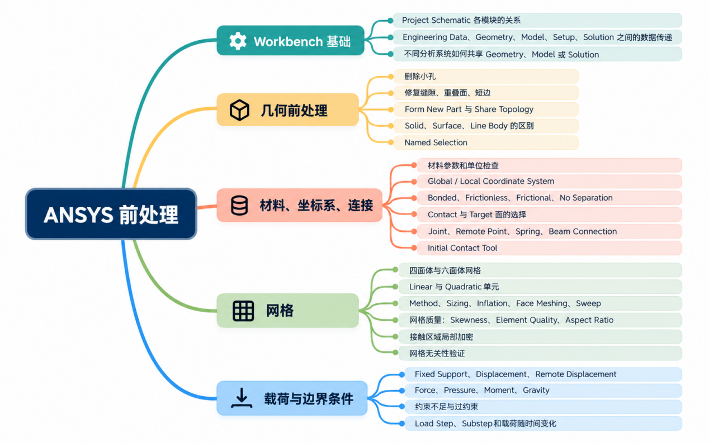

### workbench基础

单个分析系统结构：

数据共享：数据在两个模块之间共享，意味着实际上只有一个底层数据对象同时服务于两个模块。变更 单元会立即影响对方，因为它们本质上是数据相同。共享连接用方形连接器表示

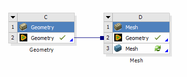

数据提供：上游模块向下游模块提供输入数据。变更上游单元将标记为需要刷新。 连接用圆形连接器表示，双方并不是同一个模型对象。

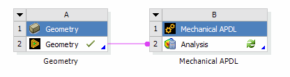

创建数据共享的方式：

1、拖动新的模块到原有模块对应位置，例如，原有静力学分析，课程Toolbox拖动模态到静力学几何上

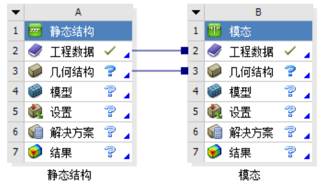

2、Geometry右键创建下游系统

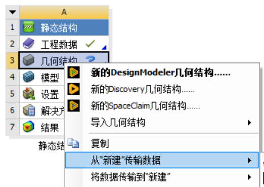

3、两分析系统直接对应拖动连接

**注意：**不能在两个已经建立好的分析系统之间事后创建Model共享；通常应从第一个系统的Model单元格直接生成第二个连接系统，如果已经分别建立了两个系统，最稳妥的做法通常是删除或保留其中一个下游系统，然后重新从上游Model生成连接系统。

创建数据提供与共享类似，用于传递Solution分析结果，是把上游的计算结果转换为下游分析的载荷、初始条件、或预应力状态。

### 几何前处理

1.  spaceclaim和discovery

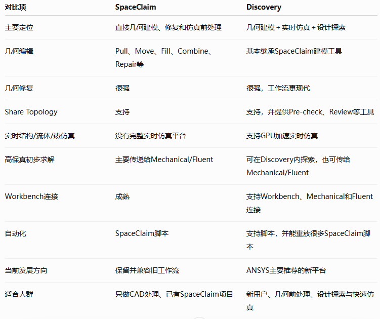

2.  Ansys Discovery

**一 主要功能**

|                    |                                                                                                                                   |
|--------------------|-----------------------------------------------------------------------------------------------------------------------------------|
| **功能**           | **说明**                                                                                                                          |
| **结构分析**       | 支持静态和动态结构分析，可快速观察变形、应力及不同振型，并估计固有频率和共振风险。                                                |
| **流体分析**       | 可探索内部流动和外部流动，观察速度、压力和流线等结果。需要更详细或更高精度分析时，可进一步使用 Refine 工作流或转入 Ansys Fluent。 |
| **热分析**         | 可分析热传导、对流和温度分布，并支持共轭传热等热流体问题，用于评估产品的热性能。                                                  |
| **拓扑优化**       | 提供交互式拓扑优化工具，可根据载荷、约束、保留区域和制造条件调整材料分布，适用于结构减重和刚度提升。                              |
| **电磁分析**       | 可在进入 Ansys HFSS 详细研究前评估初步高频电磁概念，例如天线布置和位置变化对性能的影响。相关能力取决于 Discovery 授权等级。       |
| **设计和几何建模** | 采用直接建模技术，可快速建立概念模型、零件和装配体，并能打开、修复和编辑多种 CAD 文件。                                           |
| **仿真模型准备**   | 可修改、简化、优化和参数化 CAD 模型，删除无关小特征，修复几何缺陷并建立仿真所需的几何分区，从而降低网格复杂度和求解成本。         |

**二 主要优势**

**• 即时仿真：**通过 GPU 加速和快速求解能力，在修改几何、材料或边界条件后迅速更新结果，使工程师能够在设计早期迭代更多方案。

**• 易用性强：**界面和工作流相对直观，将交互式建模与仿真设置结合，降低非专业仿真用户的入门门槛。

**• 兼顾快速探索与高精度验证：**Explore 适合快速判断设计趋势，Refine 适合进一步提高求解精度；最终方案还可传递至 Mechanical、Fluent 或 HFSS 进行专业验证。

**• 多物理场集成：**能够在统一环境中处理结构、热、流体及部分电磁问题，减少不同软件之间反复转换数据和重建模型的工作量。

**• CAD 兼容性与模型准备能力：**能够导入和编辑多种 CAD 格式，并通过几何修复、简化、参数化和直接建模工具缩短仿真准备时间。

### 网格划分

#### 网格划分方法：

以典型的3D模型为例，一般控制元素的形状使用Tetrahedrons（四面体）、Hex Dominant（六面体主导）、Sweep（扫掠法）、Multizone（多区域划分）、Cartesian（笛卡尔坐标系）的网格划分方法。

##### 1.1 四面体网格划分法

适用于实体几何模型的网格划分，尤其是对于形状不规则或较为复杂的几何体。四面体网格对实体形状的规则性要求较低，可以灵活适应各种几何结构，特别是在处理非规则形状时表现优异。在算法层可选择“补丁适形”和“补丁独立”，

##### 1.2 六面体网格划分法

六面体主导，其核心目标是在复杂几何体中尽可能生成六面体单元，同时允许存在少量的金字塔单元和四面体单元作为过渡，六面体主导，其核心目标是在复杂几何体中尽可能生成六面体单元，同时允许存在少量的金字塔单元和四面体单元作为过渡。

在同样尺寸条件下，四面体网格的结果精度相对六面体差一些，并可能会导致更大的计算量；六面体网格的计算规模较小，但需要较多的时间进行几何简化、切割，生成网格的时间较长。六面体适用于大容积实体，如发动机缸体、螺栓支架等内部空间较大的部件以及几何不规格但非薄壁结构，对体积和表面积比小的薄复杂体不适用。

##### 1.3 扫略法（sweep）

在三维空间生成六面体网格的技术，要求实体形状规则，适用于具有**明确边界和几何连续性**的结构。在Aysys中扫掠法一般是先在源面上生成面网格，然后通过选定的路径或边界生成扫掠体网格，主要形成六面体网格，其中可能会存在三棱柱网格。

一个扫掠体需满足的条件有：

1、模型必须是一个连续“体”，能够被一个或多个面（从“源面”到“目标面”）完全包裹；

2、至少有一个由边或闭合表面连接的从“源面”到“目标面”的路径；

3、没有硬性分割以致在源面和目标面相应边上有不同的分割数。

##### 1.4 多区域划分法（multizone）

适用于实体形状大致规则的情况。这种情况要求实体被自动虚拟切分成规则的子域，以便更好的生成六面体网格,适用于实体形状大致规则的情况。这种情况要求实体被自动虚拟切分成规则的子域，以便更好的生成六面体网格,该方法是一种高级的、自动化的扫掠网格划分方法，其主要有如下特点：

1、虚拟切分：首先将复杂实体分解成更简单的规则形状，如长方体或圆柱等，这些规则形状在网格中更易处理；

2、六面体网格生成：通过虚拟切分，将实体每个规则区域生成纯六面体网格

3、自动性：该方法强调自动性，减少了人工干预，提高了网格划分效率及一致性；

4、规则性要求：该方法尽管可以自动划分，但仍要求实体形状大致规则，以确保切分后的子区域适合生成规则的六面体网格。

多区域划分适用于几何形状较为规则的工程结构，如管道、支架等。同时，适用于具有混合拓扑的结构，即几何体一部分非常适合扫掠，而另一部分可能不适合。多区域方法可以只对适合的部分进行扫掠划分，其他部分采用四面体等方法。

##### 1.5笛卡尔网格划分法（cartesian）

其本质是基于空间的网格，不是基于几何的网格。软件的划分逻辑是在一个完全包围几何模型的“包围盒”内生成均匀的立方体网络，并根据模型的边界去“切割”或“标记”这些立方体，区分出流体域和固体域。因此，该方法尤为适用于流体动力学和电子散热领域。其主要特点如下：

1、阶梯状逼近：模型的弯曲或倾斜表面无法被完全贴合，而是被近似为阶梯状的锯齿形边界；

2、网格细化：为克服阶梯状逼近精度不足的问题，Cartesian网格方法会在关键区域进行多层级、自动化的局部加密，即在远离边界或梯度平缓的区域使用粗网格，在靠近边界以及物理量变化剧烈（温度、速度等）的区域自动施加多级细化网格，且该加密是各向同性的；

3、网格生成快速：完全避免了传统方法中繁琐的前处理工作，适用于处理极其复杂内部特征的几何体，且生成的立方体网格质量较好，有利于求解器的稳定性和收敛速度。

然而，基于笛卡尔网格划分的特点，该方法会影响边界层、摩擦阻力、局部传热等的计算精度，同时阶梯状的边界划分无法准确计算应力集中，因此笛卡尔划分方法几乎不用于结构的有限元仿真分析。

##### 1.6 分层四面体网格

主要针对增材制造等需要按制造层高划分的模型，并不是普通结构或流体分析的首选。官方将其定义为根据指定层高逐层建立非结构四面体网格。

####  2、网格划分对应设置

Ansys 网格划分可以分为全局控制和局部控制。局部控制的优先级高于全局控制。一般对需要重点关注或有可能产生问题的零件或位置进行局部控制，网格优化。当划分对象缺少局部控制时，软件会执行全局控制。

##### 2.1 四面体网格划分

|                                                                                                              |                                                                                                              |
|--------------------------------------------------------------------------------------------------------------|--------------------------------------------------------------------------------------------------------------|
| 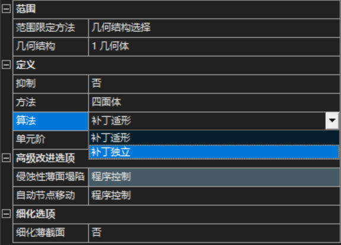 | 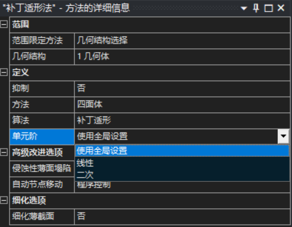 |

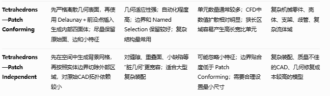

在单元阶数选择上：

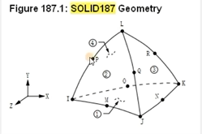

一阶四面体网格 仅在四面体网格单元角点位置布置节点，而二阶则通过中间插值的方法增加了边中间的计算节点，从仿真精度上，二阶计算网格精度也比一阶计算网格精度更高，而一般情况下，计算精度二阶六面体\>二阶四面体\>一阶六面体\>一阶四面体。一阶网格适用于对大变形，模型粗算，获取结果块，二阶网格节点多，解算方程规模大，求解时间长，结果会更精确。

##### 2.2 六面体网格划分

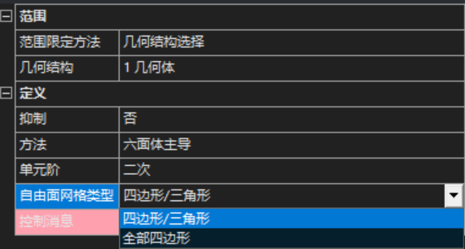

主导六面体网格划分逻辑为：实体表面生成二维网格，该网格以四边形为主→实体内推生成六面体单元→难以生成的则生成四面体，棱柱等其他网格单元。因此对于复杂模型自由面网格类型一般选择四边形/三角形,如果限定了全部为四边形则很容易无法生成完整网格，仅对相对规则，平滑的模型才适用全部四边形网格。

##### 2.3扫略法网格划分

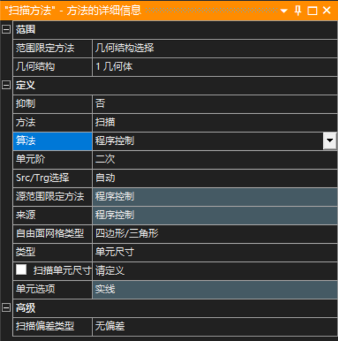

算法可选择由程序控制，也可以选择轴对称，轴对称专门用于处理扰轴旋转形成的三维实体

选择轴对称算法后，附加选项可选择中心网格：六面体/锲形

Src是Source，即源面；Trg是Target，即目标面，源面网格会沿扫掠方向复制到目标面，所以源面的网格质量非常重要。

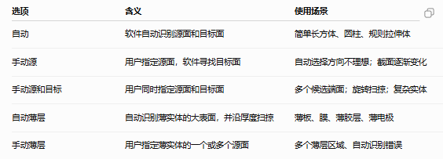

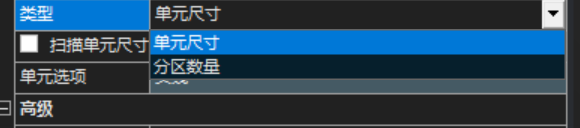

类型一栏可以指定单元格大小或者沿扫略方向生成多少段

扫描偏差类型：

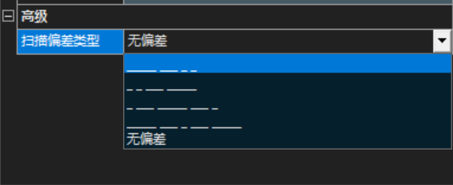

无偏差表示所有网格近似一致，适合均匀流道、材料无明显梯度变化的模型，①,②为单向偏差：单元从源面到目标面逐渐变大或变小，③为两端加密，④为中间加密

##### 2.4 多区域划分法网格划分

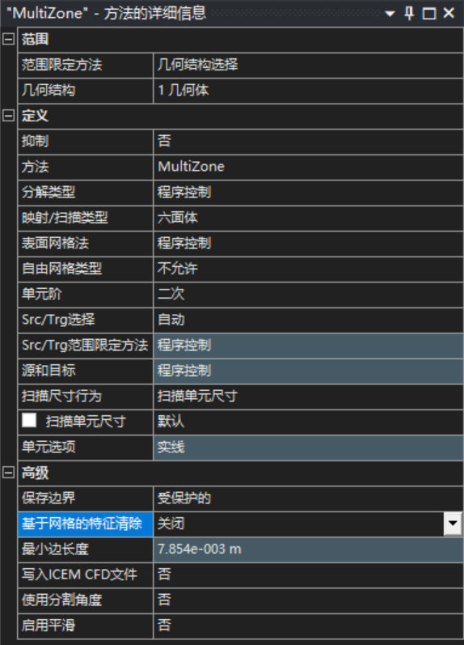

MultiZone会先分析实体拓扑，建立内部的虚拟Block，再对不同Block使用映射或扫掠方法。

它的主要优势是：

- 减少手动切割几何；

- 尽量生成六面体；

- 可以处理比普通Sweep更复杂的实体；

- 可对多体共享拓扑生成共形网格。

但它不是万能的自动六面体工具。几何存在大量碎面、分叉、小圆角或拓扑突变时，仍可能失败或产生质量较差的过渡区域

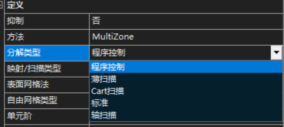

分解类型是MultiZone最核心的选项，决定软件如何把复杂实体拆分成可扫掠Block。

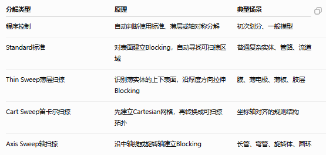

映射/扫描类型决定了MultiZone在规则Block内使用什么体单元。

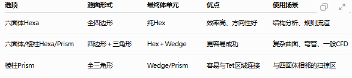

表面网格法控制MultiZone在无法直接映射的自由表面上，如何生成二维表面网格。

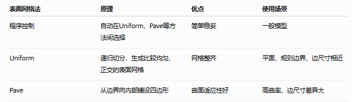

自由网格类型决定如果MultiZone发现某个区域无法生成规则Hex/Prism，是否允许用非结构网格填充。

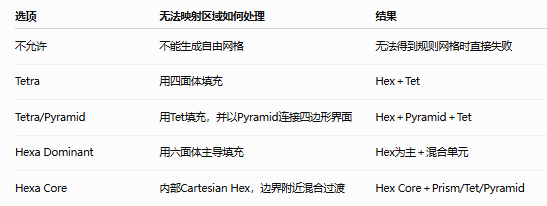

扫描尺寸行为：

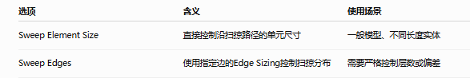

保存边界：

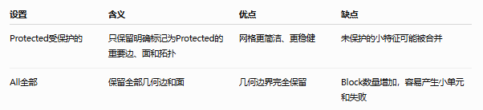

基于网格特征的清除：

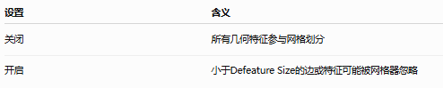

写入ICEM CFD，专业CFD网格开发，对网格划分失败、复杂网格进行高级检查

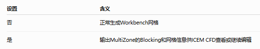

使用分割角度用于给自动分解出的Block增加额外切分线，提高网格正交性

适合：

- 侧面网格明显倾斜；

- Hex发生扭曲；

- 拐角处网格不正交；

- 渐扩或弯曲区域质量差；

- 显式动力学要求更规则单元。

原理是：当对应边之间的角度低于指定阈值时，算法增加Block切分，使网格沿几何变化重新排列。

优点：

- 改善正交性；

- 降低Skewness；

- 改善侧面网格。

缺点：

- 增加Block数量；

- 增加单元数量；

- 可能引入更多局部过渡；

- 某些复杂模型反而更容易失败。

启用平滑

开启后，网格生成完成时会适当移动内部节点，以改善：

- Element Quality；

- Skewness；

- Orthogonal Quality；

- Jacobian；

- 单元尺寸突变。

它一般不会改变网格的整体连接关系，而是调整节点位置。

适合开启：

- 网格已经生成成功，但局部质量较差；

- 弯管或曲面附近Hex扭曲；

- Block连接区域存在突然过渡；

- 求解收敛性不理想。

保持关闭：

- 网格已经非常规则；

- 需要严格保持人为设计的节点分布；

- 需要精确控制偏差网格；

- 平滑后边界层分布受到不希望的改变。

##### 2.5笛卡尔网格划分法

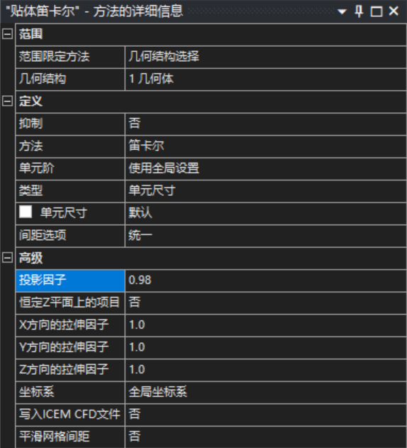

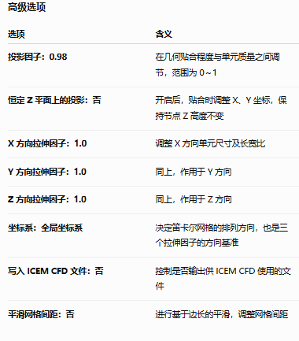

投影因子的具体效果是：

- **0**：单元更规则，但边界可能呈阶梯状；

- **接近 1**：更贴合几何，但边界单元可能畸变；

- **1**：大多数边界节点投影到几何上，仍会为避免劣质单元做调整。

##### 2.6分层四面体网格划分法

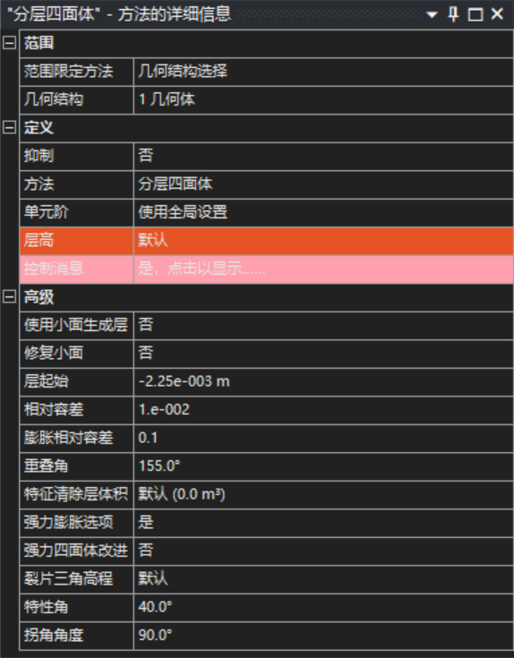

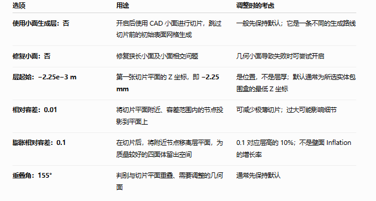

官方建议相对容差通常为 **0.01～0.02**，膨胀相对容差通常为 **0.1～0.3**。调大它们可能减少狭薄网格区域，但应检查几何细节是否仍被保留。

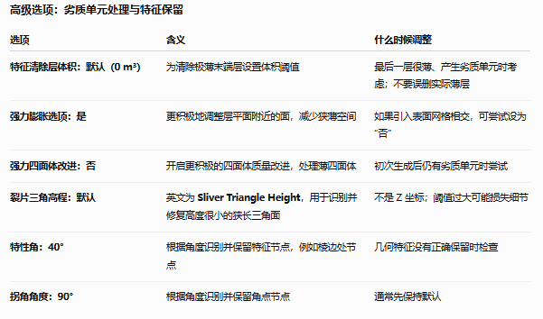

狭长三角形高度阈值默认约为最小尺寸的 **10%**，官方建议不超过最小尺寸的 **50%**。
