# case 1 机床主轴模态仿真

模态仿真研究内容：结构的固有振动特性，即结构在没有持续外部激励时，最容易以哪些频率和形态发生振动。其核心输出是固有频率和对应的振型，可用于识别共振风险，并为谐响应、随机振动和瞬态动力学分析提供基础。

## 主要研究内容

- **固有频率分析**：计算结构前若干阶固有频率，确定容易发生共振的频率范围。

- **振型分析**：观察各阶模态下结构的弯曲、扭转、拉伸或局部振动形式。

- **薄弱位置识别**：根据振型中的高位移区域，判断潜在的振动敏感区和连接薄弱位置。

- **结构参数影响**：研究材料、质量、刚度、尺寸、连接方式和边界条件对模态特性的影响。

- **结构优化**：通过改变厚度、增加加强筋、调整支撑或降低局部质量，使固有频率避开工作激励频率。

- **后续动力学分析**：将模态结果传递给谐响应、响应谱、随机振动或瞬态结构分析。

## 基本流程

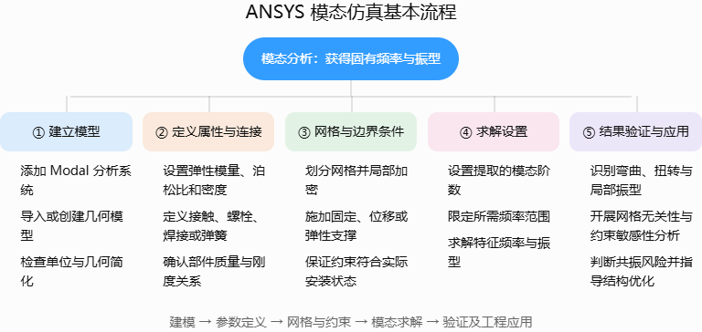

## 常见模态分析类型

## 一 静态结构分析验证

1、连接关系处理：轴承是主轴和壳体之间的内部弹性连接，轴承并不是完全刚性的连接。主轴受力时，滚珠与内外圈接触区域会发生微小弹性变形，因此主轴和壳体之间存在有限的支承刚度，因此需要将其等效为弹簧，前后轴承均设置径向刚度。前轴承可设置较大的轴向刚度，模拟定位端；后轴承轴向刚度设置较小或释放，模拟浮动端。直接处理轴承的话，模型会带来大量接触对，计算量很大，而且需要准确道：

- 滚珠数量和尺寸；

- 接触角；

- 滚道曲率；

- 预紧力；

- 过盈量；

- 转速和离心效应；

- 材料及接触参数。

对于整机模态分析，我们主要关心轴承对主轴提供了多大的径向和轴向支承，因此使用等效弹簧通常更高效。

弹簧连接关系设定时：

- **参考几何体（Reference）**：相对固定、刚度更大的部分，例如壳体或轴承座；

- **移动几何体（Mobile）**：发生运动的部分，例如主轴。

仿真结果：模型初步验证通过

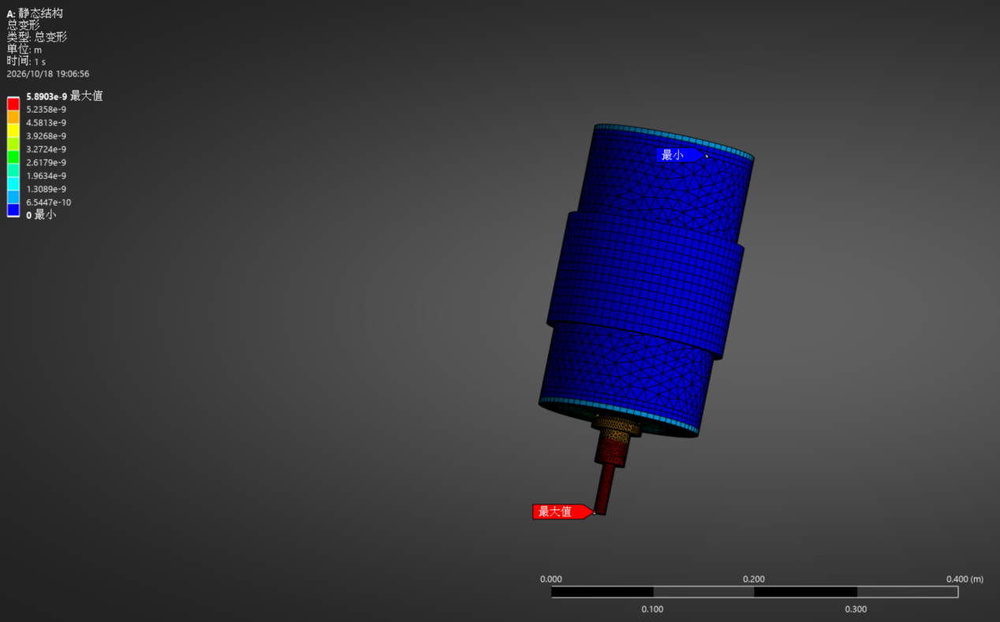

## 二 自由模态

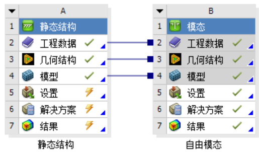

|                         |                         |
|-------------------------|-------------------------|
| 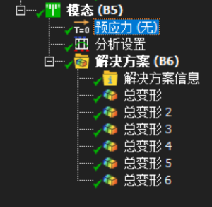 | 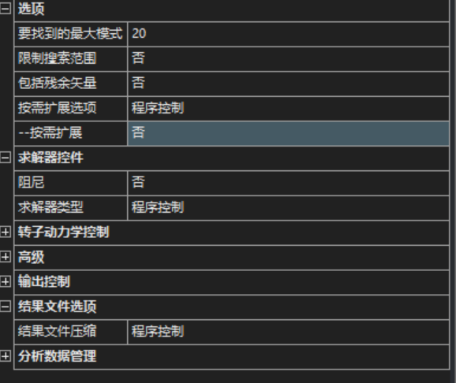 |

预应力选择无就可以设置为自由模态，分析设置选择前20阶，模型展示前6阶结果

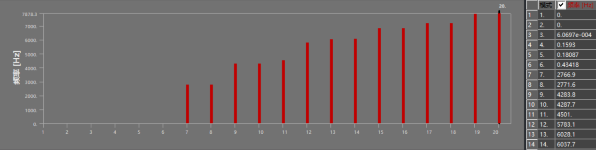

3~6阶出现小数值，是网格离散和数值舍入造成的。相对于第7阶的2766.9 Hz，可以认为它们都是0 Hz刚体模态。7/8、9/10、13/14、15/16阶成对出现接近频率，符合轴对称结构的特点。但是网格密度加密后，7/8阶频率波动较大，网格收敛性不够。

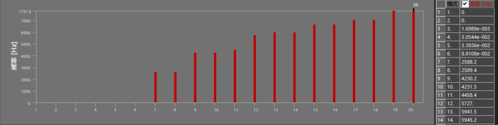

继续加密后网格单元4.5W→13W,误差在3%~5%区间，网格 收敛性好，后续计算可以将4.5W作为初始单元格进行计算。

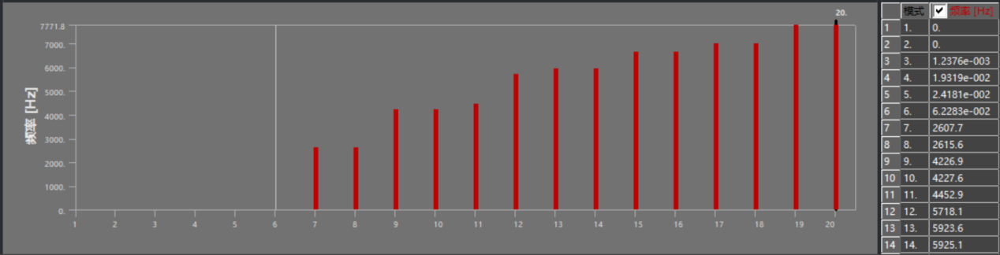

结果分析解释：

1、刚体模态

三维自由结构应有6个接近0 Hz的刚体模态：

- X、Y、Z方向平移；

- 绕X、Y、Z方向旋转。

你的模型前6阶接近0 Hz，说明自由模态设置基本正确。若出现超过6个接近0 Hz的模态，通常说明存在未连接零件。

2、固有频率

从第7阶开始是弹性模态。*f*7≈*f8=2600Hz,*可以作为第一对弹性固有频率，可用于判断工作转速及其激励频率是否接近结构固有频率

3、模态振型

自由模态可以判断每阶属于：

- 刀具弯曲；

- 主轴一阶或二阶弯曲；

- 壳体弯曲；

- 端盖局部振动；

- 主轴扭转；

- 轴向伸缩；

- 定子或冷却套局部振动。

例如，在7/8阶振型中，刀具扭转变形最大，频率接近，很可能是两个互相垂直方向的刀具—主轴弯曲模态。

4、模态变形，可在总变形中绘制查看

## 三 约束模态

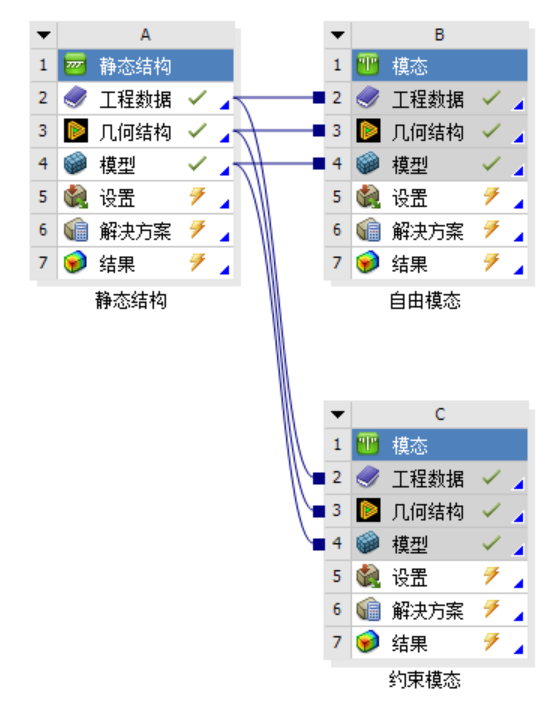

创建约束模态，施加安装约束，这里暂时假设电主轴通过下端法兰盘安装到机床上

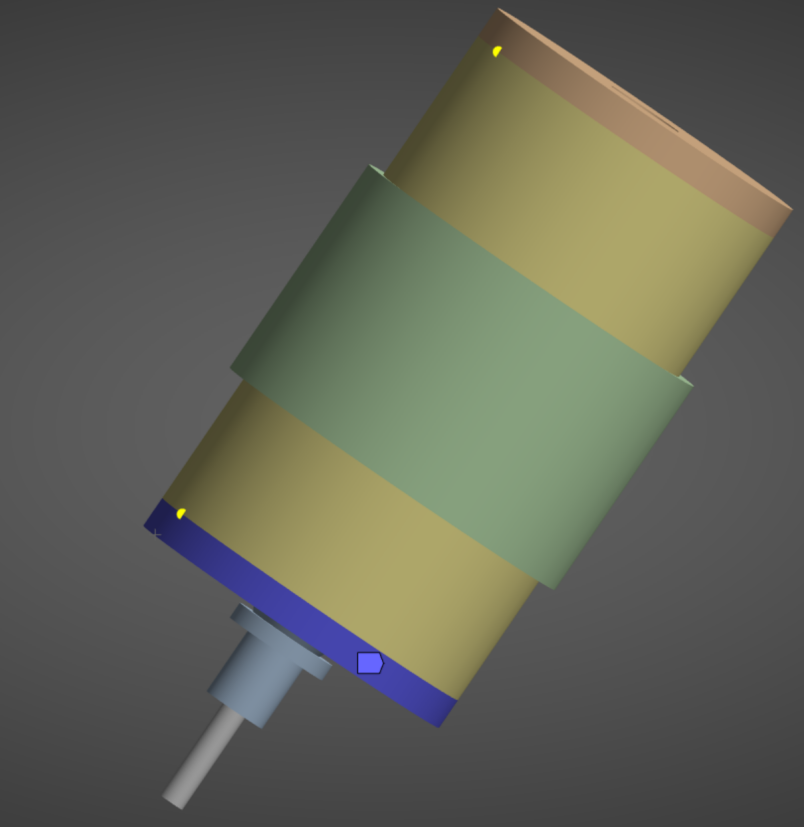

结果：

网格无关性验证通过(๑•̀ㅂ•́)و✧

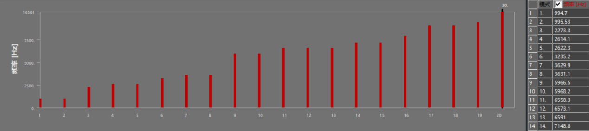

结果分析解释：

1.  模型约束生效，前六阶出现对应频率，且一阶固有频率为996Hz(电主轴也难逃996吗)

2.  初步判断共振风险：

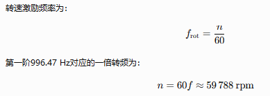

对于12000rpm的电主轴来说，1倍频才200Hz，5倍频才有1000Hz，这样的工况较难发生共振

## 四 预应力模态

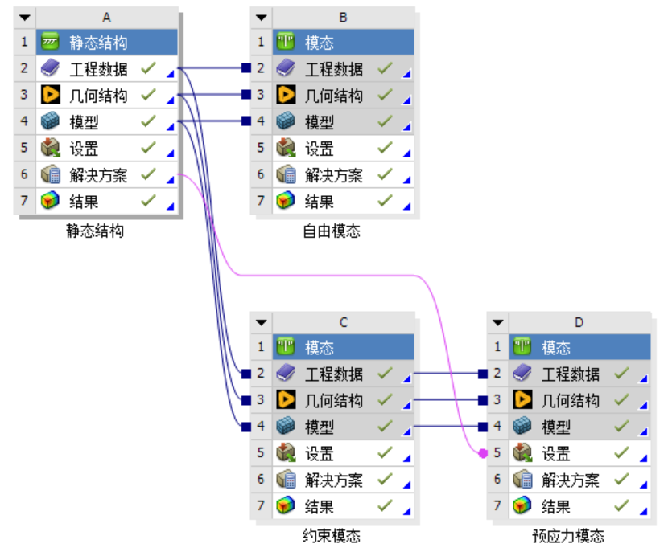

这里我们给静态结构施加主轴在某一时刻加工切削的力，具体如下表：

扭矩：轻载：0.75N·m，中载：1.5N·m，重载：3N·m，求解静态受力后，预应力设置为静态结构，同样求解前20阶，结果如下：

中载：

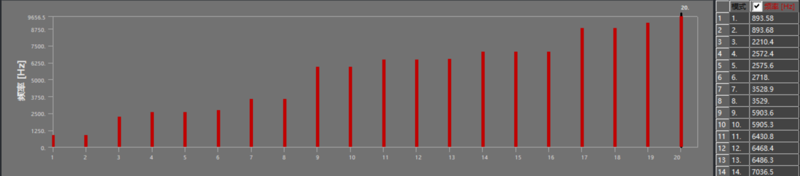

轻载：

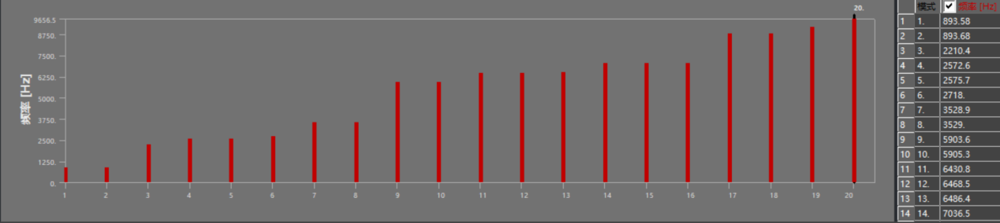

重载：

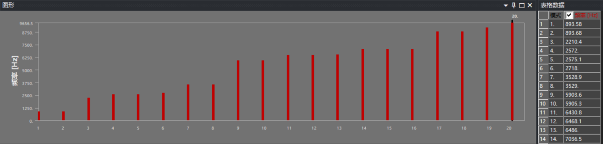

**切削力对当前模型的固有频率影响几乎可以忽略**，这在采用固定刚度的线性轴承弹簧时是正常的。切削载荷主要改变静态变形和应力，不一定明显改变结构刚度，但是之前约束模态的一阶约为 **996 Hz**，现在预应力模态为 **893.58 Hz**，原因是之前约束模态加了个仅压缩支撑，给静态结果施加同样的约束后，屏蔽切削，模态如下：

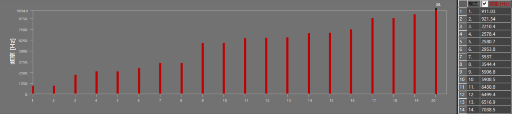

排查原因没有啥结果，选择把受力扩大十倍，结果如下，有变化，但不多，麻了，对不对挖个坑先

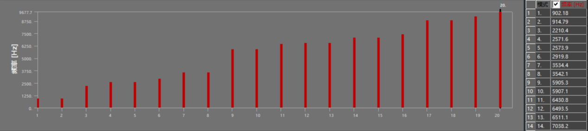

## 五 有阻尼模态

复制约束模态，分析设置开启阻尼，阻尼设置0.02，求解器类型简约的阻尼，结果：

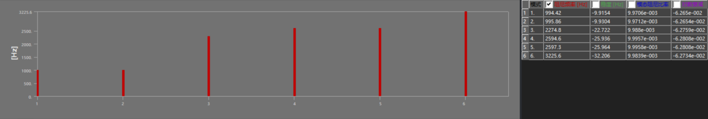

与无阻尼约束模态相比，各阶频率变化均小于0.01%，表明当前小阻尼对电主轴固有频率的影响较小。各阶模态阻尼比约为1%，稳定参数均为负值，说明各阶自由振动均随时间衰减，系统不存在负阻尼引起的自激失稳现象。第一、二阶以及第四、五阶频率成对出现，主要对应电主轴在两个相互垂直径向方向上的弯曲振型。

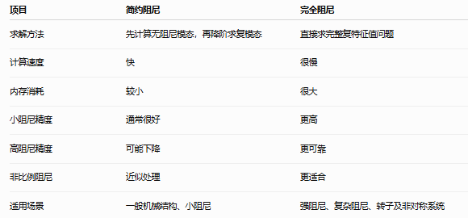

## 五 非线性接触模态

没懂，刨个坑

## 六 转子模态

复制约束模态，分析设置如图

|                           |                           |
|---------------------------|---------------------------|
| 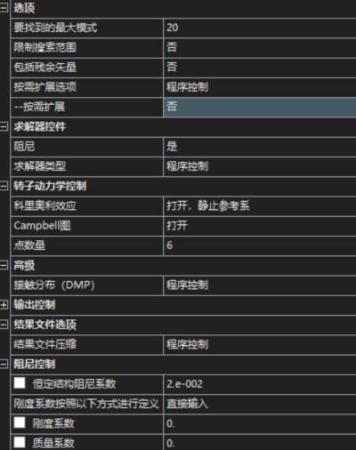 |  |

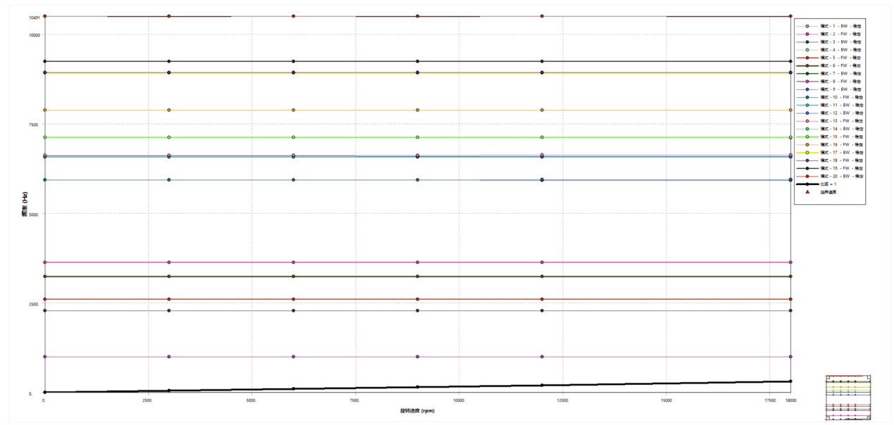

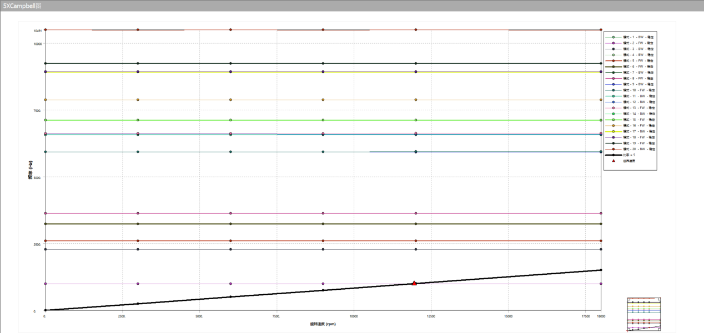

Campbell图表明，在0～18000 rpm工作转速范围内，电主轴前20阶模态均处于稳定状态，1X转频线未与模态频率曲线相交，因此不存在由转子同步不平衡激励导致的一阶临界转速。但刀齿通过频率可能与约994 Hz的一阶弯曲模态相交当存在 **5X激励** 时，应重点避开约 **11,900～12,000 rpm**。实际设计可留出至少 ±10%的避振区间，即大致避免长期运行在 **10,700～13,200 rpm**
